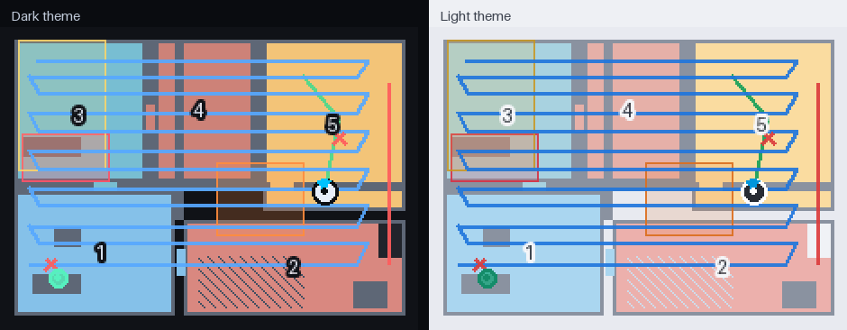

# Карта робота-пылесоса Xiaomi для Home Assistant

Кастомная интеграция, которая показывает карту уборки робота-пылесоса Roborock/Xiaomi
как **камеру** в Home Assistant, плюс несколько сенсоров с позицией и комнатой.
Аналог [Xiaomi Cloud Map Extractor](https://github.com/PiotrMachowski/Home-Assistant-custom-components-Xiaomi-Cloud-Map-Extractor),
но с настройкой через UI, современной архитектурой (`DataUpdateCoordinator`), опциями
без правки YAML и поддержкой диагностики.



## Возможности

- 📷 Камера `camera.<имя>_map` с PNG-картой: стены, комнаты в разных цветах, ковры,
  путь уборки, виртуальные стены, запретные зоны, зарядная станция, робот с направлением.
- 🧭 Сенсоры: позиция робота (x, y, угол), текущая комната, время последнего обновления.
- 🎨 Две темы (тёмная/светлая), масштаб, поворот, обрезка краёв, выбор слоёв.
- ☁️ Логин в облако Xiaomi по аккаунту Mi Home, автоматическое определение модели,
  устройства и токена; ручной режим по IP + токену.
- 🏠 **Локальный режим без облака**: карта берётся из Valetudo
  (`/api/v2/robot/state/map`) или с любого HTTP-адреса, отдающего сырой RRMap —
  аккаунт Xiaomi не нужен.
- 🔐 Reauth-поток: при смене пароля HA сам предложит войти заново.
- 📊 Диагностика: скачивание диагностики, сохранение исходного файла карты на диск,
  offline-рендер через `tools/render_map.py`.
- ⚡ Умный опрос: пока робот стоит на базе, интеграция опрашивает облако реже.
- 🧩 Совместимость с популярной карточкой
  [lovelace-xiaomi-vacuum-map-card](https://github.com/PiotrMachowski/lovelace-xiaomi-vacuum-map-card)
  через атрибут `calibration_points`.

## Требования

Home Assistant 2025.1 или новее, Python 3.13 (в HA OS/Supervised уже так).
Проверено на Home Assistant 2026.2.3.

## Поддерживаемые устройства

Поддерживаются роботы с форматом карты **RRMap** (облачный API `getmapfileurl`):

- Roborock: S5, S5 Max, S6, S6 MaxV, S7, S7 MaxV, Q7, Q7 Max, Max, E-серия и т.п.
  (`roborock.*`);
- Xiaomi Mi Robot Vacuum V1 (`rockrobo.vacuum.v1`).

Не поддерживаются: Dreame/Mijia (прошивка Dreame), Viomi, Roidmi — у них другой формат
карты. Архитектура готова к добавлению парсеров: см. `rr_map.py` и `render.py`.

## Как это работает

1. Интеграция входит в облако Xiaomi (`account.xiaomi.com`) и получает `serviceToken`.
2. Забирает список устройств и токен пылесоса.
3. Спрашивает у пылесоса по локальному протоколу miio (`get_map_v1`) имя текущей карты.
   Поэтому нужен локальный IP — робот должен быть доступен из Home Assistant по сети.
4. По имени карты облако выдаёт временную ссылку на gzip-файл карты.
5. Файл распаковывается, разбирается (RRMap: заголовок + типизированные блоки) и
   рендерится в PNG через Pillow.

В локальном режиме шаги 1-4 не нужны: интеграция запрашивает карту по HTTP
напрямую у робота или локального сервиса и разбирает её тем же рендерером.

## Установка

### HACS (рекомендуется)

1. HACS → ⋮ → **Custom repositories** → добавьте
   `https://github.com/dmitry-ponamarev/xiaomi-robot-map`, категория **Integration**.
2. Установите интеграцию и перезапустите Home Assistant.

### Вручную

Скопируйте папку `custom_components/xiaomi_robot_map` в
`<config>/custom_components/xiaomi_robot_map` и перезапустите HA.

Единственная зависимость — `pycryptodome`; Home Assistant установит её сам при первом
запуске. Пакет `python-miio` **не нужен**: локальный протокол miIO реализован внутри
интеграции (`miio_local.py`).

## Настройка

**Настройки → Устройства и службы → Добавить интеграцию → Xiaomi Robot Vacuum Map.**

0. **Источник карты** — «Облако Xiaomi» (штатная прошивка) или «Локально, без облака»
   (см. раздел ниже).
1. **Аккаунт Xiaomi** — e-mail/телефон и пароль от Mi Home, регион облака
   (обычно `de` для Европы, `cn` для Китая, `ru` для России).
   Если Xiaomi просит подтверждение (2FA), откройте ссылку из журнала HA на телефоне,
   где выполнен вход в аккаунт, и повторите.
2. **Выбор пылесоса** — список найденных устройств. Укажите локальный IP робота
   (например, `192.168.1.50`); закрепите его в DHCP, чтобы адрес не менялся.
3. Если устройства нет в списке — выберите «Enter host and token manually» и введите
   IP и 32-символьный токен. Токен проверяется по аккаунту в облаке.

## Локальный режим (без облака)

Штатный робот Roborock **не отдаёт карту по локальному протоколу**: по токену доступны
команды и имя карты, а сам файл карты лежит только в облаке Xiaomi. Поэтому «только
токен» без облака для штатной прошивки невозможен — но есть два реальных локальных пути,
и оба поддерживаются:

**1. Valetudo** (прошитый робот). Укажите адрес вида
`http://192.168.1.50/api/v2/robot/state/map`, формат — «Valetudo». Если в Valetudo
включён Basic Auth, заполните логин и пароль.

**2. Любой локальный источник сырой карты RRMap** — HTTP-адрес, отдающий `.gz`/`.bin`
файл карты (например, `local_roborock_server`, Valetudo-RE/DustBuilder, ваш скрипт):
формат «Raw RRMap file over HTTP». Если сервис требует авторизацию — Basic (логин/пароль)
или Bearer-токен.

Что происходит при добавлении: интеграция сразу скачивает карту по указанному адресу и
разбирает её, поэтому ошибки видно в момент настройки (`cannot_connect`, `invalid_format`).
Аккаунт Mi Home не запрашивается, в `.storage` попадают только адрес и, если указаны,
локальные логин/пароль.

## Сущности

| Сущность | Что показывает |
| --- | --- |
| `camera.<имя>_map` | PNG-карта, атрибуты с геометрией (см. ниже) |
| `sensor.<имя>_position` | `"x, y"` в миллиметрах, атрибуты `x`, `y`, `angle`, `room` |
| `sensor.<имя>_current_room` | Номер комнаты (или имя из опций), атрибуты со списком комнат |
| `sensor.<имя>_map_updated` | Время последнего успешного обновления карты |

Атрибуты камеры (используются карточками Lovelace):

- `map_name`, `map_index`, `map_sequence`, `map_version`, `map_age`, `raw_size`;
- `calibration_points` — 3 точки «координаты робота ↔ пиксели карты»;
- `rooms` — bounding box каждой комнаты, `vacuum_room`;
- `vacuum_position`, `charger`;
- `no_go_areas`, `no_mopping_areas`, `no_carpet_areas`, `virtual_walls`, `zones`;
- `path` — точки пути уборки;
- `image_width`, `image_height`, `theme`, `scale`, `rotation`, `error`.

## Опции

**Настройки → Устройства и службы → Xiaomi Robot Vacuum Map → Настроить**:

- интервал обновления (5–600 с) и интервал в простое (60–3600 с);
- тема карты, слои для отрисовки, масштаб, поворот, обрезка (`слева, сверху, справа, снизу` в %);
- названия комнат в виде `1: Кухня, 2: Зал` (попадут в сенсор текущей комнаты);
- ручное имя карты (если автоопределение не работает);
- сохранение исходной карты на диск (`<config>/xiaomi_robot_map/<entry_id>.bin`).

## Lovelace

Простое отображение:

```yaml
type: picture-entity
entity: camera.robot_vacuum_map
camera_view: auto
aspect_ratio: "4:3"
```

Карточка с зонами, комнатами и путём:

```yaml
type: custom:xiaomi-vacuum-map-card
camera_calibration: true
entity: vacuum.robot_vacuum
map_source:
  camera: camera.robot_vacuum_map
calibration_source:
  camera: true
```

## Сервисы

```yaml
# Принудительно обновить карту, игнорируя паузу для простоя
service: xiaomi_robot_map.refresh
target:
  entity_id: camera.robot_vacuum_map

# Получить PNG в base64 и разобранные атрибуты (ответ сервиса)
service: xiaomi_robot_map.get_map
data: {}
response_variable: map
```

Пример автоматизации «сохранить карту после уборки»:

```yaml
automation:
  - alias: "Сохранить карту после уборки"
    triggers:
      - trigger: state
        entity_id: vacuum.robot_vacuum
        to: "docked"
    actions:
      - action: xiaomi_robot_map.get_map
        response_variable: map
      - action: notify.persistent_notification
        data:
          title: "Карта уборки"
          message: "Комнат: {{ map.attributes.rooms | count }}, точек пути: {{ map.attributes.path_points }}"
```

## Если не проходит вход в аккаунт Xiaomi

Начиная с 1.1.1 форма входа показывает **код и текст ошибки, которую вернул Xiaomi**.
По ним видно причину:

| Что показывает | Что делать |
| --- | --- |
| `87001: 验证码输入错误` (капча) | Xiaomi требует капчу для этого IP/аккаунта. Откройте Mi Home (веб или приложение) из той же сети, что и Home Assistant, войдите — и сразу повторите в HA. Помогает также отключить VPN/прокси у HA и сменить DNS. |
| `70016: 登录验证失败` | «Неверные данные». Проверьте: используется аккаунт **Mi Home**, а не Roborock; телефон вводится с кодом страны (`+7...` или `7...`); пароль актуальный; регион облака соответствует аккаунту. |
| `70016` + ссылка `notificationUrl` | Включена двухфакторная проверка. Откройте ссылку **с того же внешнего IP**, что у Home Assistant, подтвердите вход и повторите. |
| `cannot_connect` | HA не достучался до `account.xiaomi.com` — DNS/файрвол/прокси. |

Аккаунт, созданный в приложении **Roborock**, для облака Xiaomi (`sid=xiaomiio`) не
подходит — нужен именно Mi Home. Если войти в аккаунт не получается принципиально,
используйте локальный режим (Valetudo или локальный RRMap-источник) — он вообще не
требует аккаунта Xiaomi.

## Диагностика

- **Скачать диагностику** на странице интеграции — конфиг (без пароля и токена),
  интервал, ошибка последнего обновления, размер карты.
- Включите «Сохранять исходную карту на диск» и отрендерите файл локально:

```bash
python tools/render_map.py /config/xiaomi_robot_map/<entry_id>.bin map.png \
    --theme light --scale 2 --rotate 90 --layers all --room-numbers --json
```

- Если карта не появляется: проверьте, что робот в сети (`ping <IP>`), что IP не
  изменился, и посмотрите журнал по фильтру `custom_components.xiaomi_robot_map`.
  Типичные причины: неверный регион облака, истёкший пароль, робот выключен или
  не успел отдать имя карты после уборки.

## Известные ограничения

- Штатная прошивка: нужен доступ в интернет, карта хранится в облаке Xiaomi и локально
  её взять нельзя. Полностью локально работает только режим Valetudo / локального
  RRMap-источника.
- Имя карты забирается по локальному протоколу miio, поэтому IP робота обязателен.
- Пароль аккаунта хранится в `.storage` Home Assistant — как и у других облачных
  интеграций. Используйте отдельный аккаунт Mi Home с доступом к дому, если это важно.
- Один config entry — один робот. Несколько роботов добавляются отдельными записями.
- Формат карт Dreame/Viomi/Roidmi пока не реализован.
- Карты, обрезанные/повёрнутые в опциях, отдают `calibration_points` уже с учётом
  трансформации, поэтому карточка Lovelace работает корректно.

## Разработка

```
custom_components/xiaomi_robot_map/
├── __init__.py        # setup/unload, сервисы, runtime_data
├── config_flow.py     # UI-настройка, reauth, опции
├── coordinator.py     # опрос, парсинг, рендер, кэш простоя
├── cloud.py           # логин и RC4-API Xiaomi
├── miio_local.py      # минимальный клиент miIO (handshake + get_map_v1)
├── provider.py        # имя карты (miio) + скачивание блоба
├── rr_map.py          # парсер RRMap (без зависимостей от HA)
├── render.py          # рендер PNG (Pillow)
├── camera.py, sensor.py, entity.py, diagnostics.py
└── translations/      # en, ru
tests/                 # юнит- и интеграционные тесты (pytest-homeassistant-custom-component)
tools/render_map.py    # offline-рендер карты
```

```bash
python -m venv .venv && . .venv/bin/activate
pip install -r requirements_test.txt
pytest -q
ruff check .
```

Тесты покрывают парсер (все типы блоков, обрезанные файлы), рендер (координаты,
поворот, масштаб, обрезка), подпись запросов к облаку (сверено с эталонной
реализацией), config/options/reauth-потоки и работу сущностей в реальном HA.

## English summary

A HACS-compatible custom integration that renders the map of Roborock/Xiaomi
vacuums (RRMap format) as a Home Assistant camera, with position/room sensors.
Setup is done in the UI: either sign in to the Mi Home cloud, pick the vacuum and
enter its LAN IP, or choose the local mode (no Xiaomi account) and point the
integration at Valetudo's map endpoint or any HTTP source of a raw RRMap file. The integration logs in to the Xiaomi cloud, reads the current map
name from the robot over the local miIO protocol (implemented in `miio_local.py`,
no python-miio needed), downloads the gzip map blob, parses it and renders a PNG
with Pillow. Options: theme, layers, scale, rotation, crop, polling intervals,
room names. Services: `xiaomi_robot_map.refresh` and `xiaomi_robot_map.get_map`.
Requires internet access for the cloud and a reachable robot IP; Dreame, Viomi
and Roidmi map formats are not implemented.

## Лицензия

MIT. Проект не связан с Xiaomi/Roborock. Используйте на свой риск.
